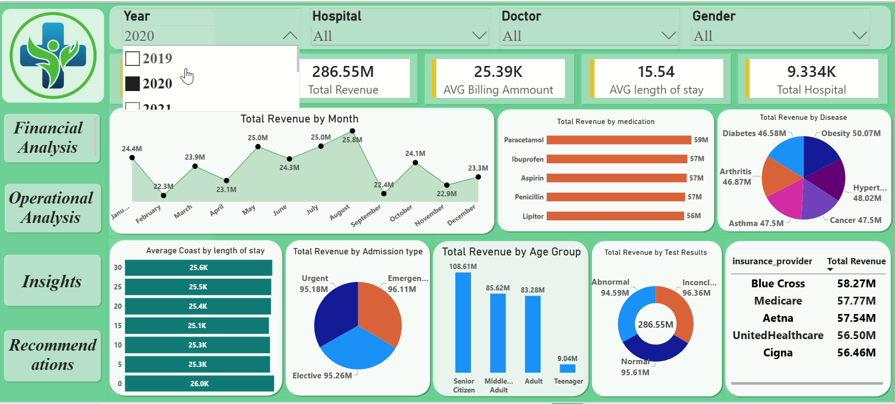
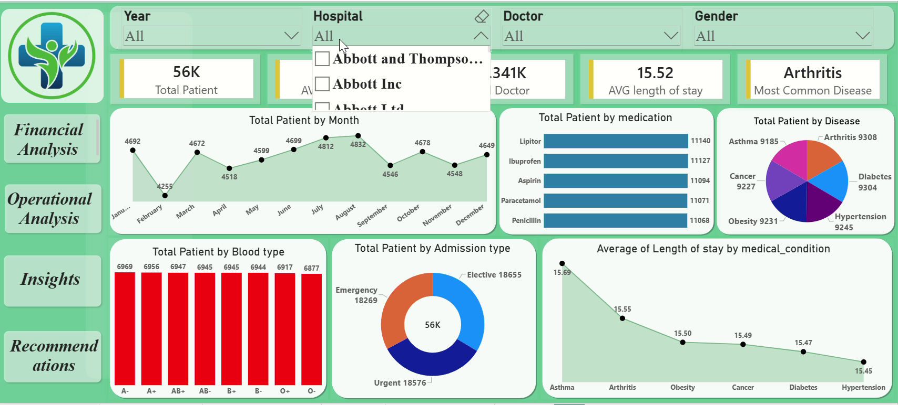
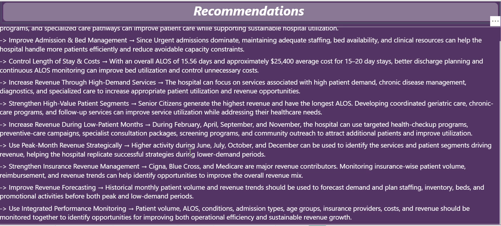

<div align="center">

# 🏥 Healthcare Data Analysis | Power BI Dashboard

**Turning healthcare data into actionable financial and operational insights**

[](https://powerbi.microsoft.com/)
[](https://learn.microsoft.com/power-query/)
[](https://learn.microsoft.com/dax/)

</div>

---

## 📌 Project Overview

This project presents an interactive **Healthcare Data Analysis Dashboard** developed using Microsoft Power BI. It explores healthcare operations and financial performance through patient, hospital, doctor, admission, medical-condition, medication, and billing data.

The dashboard is designed to help users monitor key performance indicators (KPIs), explore trends through interactive filters, identify patterns in patient activity and revenue, and translate findings into practical recommendations.

> **Project focus:** Financial Analysis • Operational Analysis • Patient Analysis • Business Insights • Recommendations

## 📸 Dashboard Preview

### Financial Analysis


### Operational Analysis


### Recommendations


---

## 🎯 Project Objectives

- Monitor overall patient volume and healthcare performance.
- Analyze revenue trends across months, medical conditions, and insurance providers.
- Understand patient distribution by age group, gender, blood type, and admission type.
- Explore operational indicators such as average length of stay.
- Compare performance using hospital, doctor, year, and gender filters.
- Identify improvement opportunities and develop data-driven recommendations.

---

# 🔄 Project Workflow — Phase by Phase

## Phase 1 — Data Collection & Understanding

**Goal:** Understand the dataset and define the analytical requirements.

- Reviewed the healthcare dataset and its available fields.
- Identified key dimensions, including patient, hospital, doctor, date, medical condition, medication, and insurance provider.
- Identified numerical fields such as billing amount and length of stay.
- Defined the main business questions and KPIs for the dashboard.

## Phase 2 — Data Cleaning & Transformation

**Tool:** Power Query

**Goal:** Prepare the raw data for reliable analysis.

- Reviewed column names and data types.
- Checked data quality, missing values, and duplicate records.
- Standardized fields and formats where required.
- Prepared date and numerical fields for analysis.
- Loaded the transformed data into Power BI.

## Phase 3 — Data Modeling

**Tool:** Power BI

**Goal:** Organize the data to support analysis and reporting.

- Reviewed the structure of the imported data.
- Set up the data model and relationships where required.
- Organized fields for use in measures, visuals, and filters.
- Prepared the model for interactive report development.

## Phase 4 — DAX Measures & KPI Development

**Tool:** DAX

**Goal:** Create meaningful metrics for monitoring healthcare performance.

The dashboard includes KPI measures such as:

- Total Patients
- Total Revenue
- Average Billing Amount
- Average Length of Stay
- Total Hospitals
- Total Doctors
- Average Patient Age
- Most Common Medical Condition

*The exact measure definitions and aggregation logic should be documented in the PBIX file or a separate DAX reference if you choose to publish them.*

## Phase 5 — Dashboard Design & Visualization

**Tool:** Power BI

**Goal:** Present complex healthcare data in a clear and interactive format.

The report is organized into the following analytical sections:

### 5.1 Financial Analysis

- Total revenue overview.
- Monthly revenue trend.
- Revenue by medication.
- Revenue by medical condition.
- Revenue by insurance provider.
- Revenue distribution across the available categories.

### 5.2 Operational Analysis

- Patient volume by month.
- Patient distribution by medication.
- Patient distribution by medical condition.
- Patient distribution by blood type.
- Patient distribution by admission type.
- Average length of stay by medical condition.

### 5.3 Insights

The dashboard supports exploration of:

- Patient demographics and age-group patterns.
- Monthly patient and revenue fluctuations.
- Revenue contribution by medical condition and insurance provider.
- Patient admission patterns.
- Differences in average length of stay across medical conditions.

### 5.4 Recommendations

A dedicated recommendations section translates the analysis into potential actions, including:

- Improving admission and capacity planning.
- Monitoring high- and low-demand periods.
- Reviewing revenue opportunities across services and medical conditions.
- Strengthening resource allocation and operational monitoring.
- Using historical trends to support staffing and inventory planning.

## Phase 6 — Interactive Filtering

The dashboard includes slicers for:

- **Year**
- **Hospital**
- **Doctor**
- **Gender**

These filters allow users to explore the report from different perspectives and compare selected segments.

## Phase 7 — Insights & Business Recommendations

**Goal:** Convert dashboard findings into decisions that can be evaluated by healthcare stakeholders.

The analysis can support:

- Better planning during periods of changing patient volume.
- Monitoring of revenue contribution across service categories.
- More informed allocation of staff and hospital resources.
- Review of insurance-provider performance.
- Ongoing tracking of patient and operational KPIs.

Recommendations should be validated against actual hospital capacity, service costs, patient outcomes, and business policies before implementation.

---

## 📊 Key Dashboard Components

| Area | What it helps analyze |
|---|---|
| KPI Cards | High-level healthcare performance |
| Financial Analysis | Revenue trends and revenue contribution |
| Operational Analysis | Patient activity and length of stay |
| Patient Analysis | Demographic and admission patterns |
| Interactive Slicers | Year, hospital, doctor, and gender filtering |
| Insights & Recommendations | Findings and potential improvement actions |

## 🧰 Tools & Technologies

| Tool / Technology | Purpose |
|---|---|
| Microsoft Power BI | Dashboard development and reporting |
| Power Query | Data cleaning and transformation |
| DAX | Measures and KPI calculations |
| Data Modeling | Structuring data for analysis |
| Data Visualization | Communicating trends and findings |

## 💼 Skills Demonstrated

- Data Cleaning & Transformation
- Power Query
- Data Modeling
- DAX Measures
- KPI Development
- Interactive Dashboard Development
- Financial & Operational Analysis
- Data Visualization
- Business Intelligence
- Insight Generation & Recommendations

---

## 📁 Repository Structure

```text
Healthcare-Data-Analysis/
│
├── Dataset/
│   └── healthcare_dataset.csv
│
├── Dashboard/
│   └── Healthcare_Data_Analysis.pbix
│
├── Screenshots/
│   ├── Financial-Analysis.png
│   ├── Operational-Analysis.png
│   └── Recommendations.png
│
└── README.md
```

**Note:** The screenshot files are included in this README package. Add your actual `.pbix` and dataset files to the matching folders, and update filenames if they differ.

## 🚀 How to Explore the Project

1. Clone or download this repository.
2. Open the `.pbix` file using Microsoft Power BI Desktop.
3. Use the slicers to filter by year, hospital, doctor, and gender.
4. Explore the Financial Analysis and Operational Analysis sections.
5. Review the Insights and Recommendations section.

## 🔍 Conclusion

This project demonstrates how Power BI can be used to transform healthcare data into an interactive analytical report. By combining financial and operational analysis with patient-level trends, the dashboard provides a structured view of healthcare performance and supports more informed, data-driven decision-making.

---

## 👨‍💻 Author

**Jitendra Kumar**  
Aspiring Data Analyst | Power BI | SQL | Excel

Thank you for visiting this project!

If you find this repository useful, please consider giving it a ⭐.
